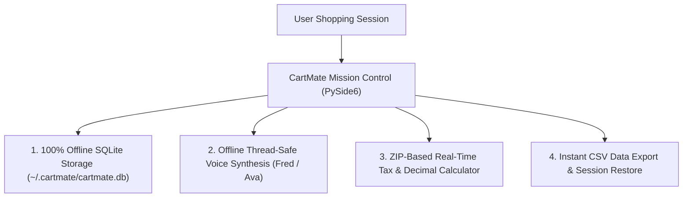

# 🛒 CartMate — Mission Control & Sovereign Product Story

[](https://github.com/aoxendine3/CartMate)
[](#)
[](#)
[](#)

> **"CartMate is not just a shopping list—it is a Mission Control center for personal commerce. Built on zero-leak privacy, local-first intelligence, and effortless voice interaction."**

---

## 🌟 The Out-of-the-Box Vision

Traditional shopping tools force users to surrender private purchase data to central ad-networks. **CartMate flips the script**:



---

## 🚀 Key Architectural Pillars

### 1. 🔒 Zero-Leak Local Sovereignty
- All session logs, item histories, and ZIP tax calculations are executed **100% locally** on your device.
- Zero tracking pixels, zero ad-network telemetry, zero cloud dependency.

### 2. 🎙️ Offline Conversational Voice Assistant ("Fred")
- Integrated thread-safe voice engine capable of reading real-time subtotal, tax, and total breakdowns without freezing the UI.

### 3. 🎨 Gen-Z Inspired Modern Aesthetic
- Vibrant gradient accents (`#7b61ff` → `#ff61a6`), rounded card frames, responsive controls, and high-visibility typography built for instant usability.

---

## 🛠️ Installation & One-Command Launch

```bash
# Clone the repository
git clone https://github.com/aoxendine3/CartMate.git
cd CartMate

# Create virtual environment & install dependencies
python3 -m venv venv
source venv/bin/activate
pip install -r requirements.txt

# Launch CartMate Mission Control
python cartmate_desktop.py
```

---

## 🗺️ Product Roadmap

- [x] **v0.1.0 (Solid Foundation):** PySide6 GUI, local SQLite DB, offline TTS, CSV export, decimal tax calculator.
- [ ] **v0.2.0 (Real-Time API):** Server-side TaxJar/Avalara API hooks + real-time Speech-to-Text (STT) voice input.
- [ ] **v1.0.0 (Production Distribution):** Standalone signed `.dmg` installer for macOS & `.exe` for Windows.

---

*Architected & Built with Truth, Integrity, and Meticulous Engineering.*
